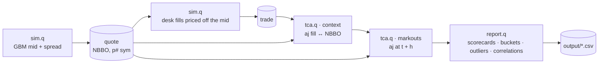

# Execution Quality & Transaction Cost Analysis — kdb+/q

Did the desk get best execution today, which brokers and venues cost money, and which ones actually carry information?
This project answers those questions in **pure kdb+/q** on one simulated US equity session: ~157k NBBO updates and 10,000 desk fills across 5 stocks, 5 brokers and 4 venues.

> All data is simulated. This is a personal project to practise the analytics a trading desk or a TCA team runs every day on tick data.

---

## What it answers

| Business question | Analysis | Core q technique |
|---|---|---|
| Was each fill at or inside the market? | Best-execution flag vs prevailing bid/ask | `aj` as-of join |
| How much did we pay versus the mid? | Slippage in bps, notional-weighted | vector conditionals `?[;;]`, `wavg` |
| Was the trade good *after the fact*? | Markouts at 1 s, 5 s, 1 min, 5 min | `aj` on shifted time, `each` over a dictionary |
| Which broker / venue performs best? | Scorecards: cost, best-ex rate, edge, alpha | functional select `?[t;c;b;a]` |
| When in the day do we make or lose edge? | 15-minute buckets, top / bottom buckets | `xbar` on `time.minute` |
| Does edge scale with activity? | Correlation of edge with volume, trade count, notional | `cor` over a column dictionary |
| Any fat fingers or abnormal fills? | Size vs symbol median, slippage z-score per broker | `fby` |

## Architecture



## Simulation model

**Quotes.** Each symbol's mid follows a geometric Brownian motion sampled at random times through the session (09:30–16:00). Bid and ask sit around the mid with a random spread (1–3× the symbol's typical spread) and are rounded outward to the cent, so the book is never crossed.

**Fills.** Each desk order is priced off the prevailing mid with a cost made of four parts:

$$\text{cost}_{bps} = \text{broker bias} + \text{venue bias} + 0.2 \times \frac{\text{qty}}{1000} + \varepsilon,\quad \varepsilon \sim N(0,1)$$

Three behaviours are built in so the analytics have something real to find:

- **BRK_E is expensive** (+1.8 bps): the scorecard should rank it last on cost and best-ex rate.
- **BRK_C is informed**: 65 % of its orders trade in the direction of the next minute's move. It is cheap at arrival *and* its markouts turn positive with the horizon, which a cost-only view would miss.
- **Fat fingers**: about 0.4 % of orders get a quantity ×25, for the `fby` screens to catch.

The run is reproducible (`\S 42`).

## Analytics

**Market context with an as-of join.** Every fill gets the NBBO prevailing at its timestamp:

```q
c:aj[`sym`time;trades;select sym,time,bid,ask from quote];
update slipBps:1e4*sgn*(px-mid)%mid,
       edge:sgn*(mid-px)*qty,
       exQuality:?[side=`B;px<=ask;px>=bid] from c
```

**Markouts** reuse `aj` on the fill time shifted by each horizon, one column per horizon:

```q
horizons:`mo1s`mo5s`mo1m`mo5m!0D00:00:01 0D00:00:05 0D00:01:00 0D00:05:00;
withMarkouts:{[c;q] c,'flip markout[c;q] each horizons};
```

**Scorecards** are one generic functional select, so the same code ranks brokers, venues or symbols:

```q
scorecard:{[c;g] ?[c;();(enlist g)!enlist g;`trades`notional`slipBps`bestExRate`edge`mo1m!(
  (count;`i);(sum;`notional);(wavg;`notional;`slipBps);(avg;`exQuality);(sum;`edge);(sum;`mo1m))]};
```

**Outliers with `fby`**, without nested queries:

```q
select from c where qty>10*(med;qty) fby sym
select from c where 3<abs (slipBps-(avg;slipBps) fby broker)%(dev;slipBps) fby broker
```

**Intraday profile and correlation:**

```q
bars15:select trades:count i,qty:sum qty,notional:sum notional,edge:sum edge by minute:15 xbar time.minute from c;
d:exec edge,qty,trades,notional from 0!bars15;
cor[d`edge] each d
```

## Quickstart

Requires kdb+ 4.x (the free personal edition from KX works).

```bash
git clone https://github.com/matthieu-briche/kdb-execution-quality-tca.git
cd kdb-execution-quality-tca
q tests/test.q     # unit tests on a hand-checked micro dataset
q src/report.q     # simulate the session, print the report, export output/*.csv
```

`report.q` prints the best-execution rate, broker and venue scorecards, the broker markout curve, the best and quietest 15-minute buckets, the edge correlations and the outliers, with timings for the `aj` steps. The session stays open with every table in memory (`ctx`, `brokerCard`, `bars15`…) for further queries.

## Project layout

```
src/
  sim.q      quote and fill simulator (namespace .sim)
  tca.q      TCA library: context, markouts, scorecards, buckets, outliers (namespace .tca)
  report.q   end-to-end run and CSV export
tests/
  test.q     13 unit tests, exit code 1 on failure
```

## Related projects

- [kdb-hawkes-simulation-one-day](https://github.com/matthieu-briche/kdb-hawkes-simulation-one-day) — Hawkes-driven quote simulation, statistical validation and MLE in q
- [kdb-q-tick-data-analytics](https://github.com/matthieu-briche/kdb-q-tick-data-analytics) — full tick architecture (TP, RDB, HDB, RTE, gateway) driven from Python with PyKX

## License

MIT
